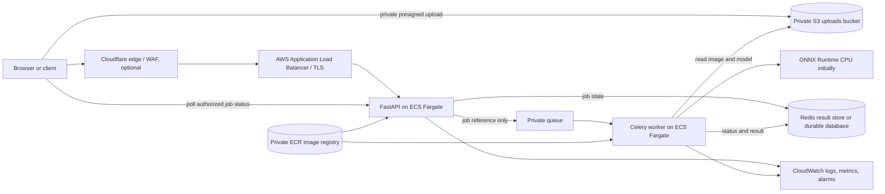

# Production Deployment Implementation Guide

**Prepared:** 2026-09-30
**Scope:** A project-specific implementation roadmap for an edge/API/inference/queue/AWS deployment. This is a plan, not a claim that the current model is clinically validated or ready to diagnose.

## Recommended Direction

For this project, build toward **Cloudflare (optional) -> AWS Application Load Balancer -> ECS Fargate API and worker services -> private S3 and a private queue/result store**. Push versioned images to ECR and use CloudWatch for logs, metrics, and alarms.

Start with a synchronous API for local development and a measured baseline. Add the queue only if prediction latency, concurrency, or proxy timeout measurements justify it. A 3-10 second request is a reason to evaluate asynchronous jobs, not proof that Celery/Redis is automatically required.

Two corrections to the supplied requirements:

- FastAPI is a popular modern choice, not a universal industry standard. Flask can also be deployed safely. FastAPI is reasonable here because the API is being redesigned and typed request/response schemas and generated OpenAPI docs are useful.
- FastAPI is ASGI. Gunicorn's default worker is WSGI and cannot serve FastAPI directly. Use Uvicorn (FastAPI's deployment docs recommend a single process per container in orchestrated deployments), or a specifically configured and supported ASGI worker. Scale ECS tasks first; use multiple server workers inside a task only after measuring memory and throughput. Each process can load another copy of the ML model.

## Target Architecture



The diagram is a later-stage target, not a requirement to launch every AWS service on day one. For a small portfolio demonstration, first run API + model locally, then add Docker Compose with Redis and a worker, then deploy to ECS. For production-scale asynchronous jobs on AWS, evaluate SQS as the broker; Celery supports it, and it removes the need to operate Redis as a message broker. Redis/ElastiCache can still be a short-lived result cache if needed.

## Project-Specific Starting Point

The current project has a Flask `webapp.py`; `/predict` accepts a base64 JSON
body and prediction writes to one shared `inputImage.jpg`. The current app no
longer registers a public `/train` route. The Dockerfile starts Flask's
development server, and `requirements.txt` combines inference, training,
notebooks, plotting, DVC, and development dependencies.

Before production work:

- Follow the existing [Model Research and Production Safety](MODEL_RESEARCH_AND_PRODUCTION_SAFETY.md) gates. In particular, the current dataset/evaluation and train-versus-inference preprocessing are not reliable enough to support clinical claims.
- Keep training out of the public serving app (the route is absent from the current Flask source). Train offline in a controlled workflow and publish a versioned model artifact separately.
- Replace the shared image path with validated in-memory image handling or unique temporary objects. Never put raw image bytes/base64 into Redis task messages or logs.
- Split runtime, training, and development dependencies. Keep Jupyter, DVC, plotting, and training-only packages out of the inference image unless the runtime actually imports them. Add FastAPI/ASGI, ONNX Runtime, Celery, Redis/SQS, and AWS SDK dependencies only when the corresponding phase is implemented; pin/lock them then.
- Keep the existing pinned TensorFlow environment as the conversion/training environment initially. The inference container can use `onnxruntime` instead of TensorFlow only after conversion and parity checks pass.

## Phase 0: Establish a Valid Model Release

Do this before optimizing or exposing an inference endpoint:

1. Resolve the data split and preprocessing issues described in the model safety report. Create patient/lesion/source-aware train, validation, and untouched test partitions where identifiers permit.
2. Verify the current binary classifier head, source-to-binary label mapping,
   and loss/activation pairing, then retrain. The current source uses one
   sigmoid output with binary directory labels; verify the stored checkpoint
   matches that source. Save the class index map and exact preprocessing
   configuration with the artifact.
3. Record the source commit, data manifest/hash, training parameters, library versions, model checksum, evaluation metrics, and intended inference input contract.
4. Review test errors and subgroup performance with appropriate domain
   expertise. The current binary folders contain about 25,000 images, but
   provenance, patient independence, label mapping, and independent test
   performance have not been established; do not claim diagnostic utility.

**Exit gate:** Reproducible model artifact; inference preprocessing matches training; independent held-out evaluation; documented limitations and model version.

## Phase 1: Separate the API From the Model

Create clear modules rather than leaving request parsing, disk writes, model loading, and prediction in one Flask file. One reasonable structure is:

```text
src/vgg16classifier/
  api/                 # FastAPI routes and schemas
  inference/            # model loader, preprocessing, prediction service
  workers/              # Celery application and prediction task
  config/               # environment-based settings
```

The exact folder names can follow the current package conventions. The API should define:

- `GET /health/live` for process liveness and `GET /health/ready` for readiness (model loaded and dependencies available). Do not expose secrets or detailed infrastructure state in these responses.
- `POST /v1/predictions` accepting multipart image upload for the first version, with a strict compressed-byte limit and decoded dimensions/pixel limit. Validate actual file contents, not only a filename or content-type header.
- A versioned response schema with named class probabilities, `model_version`, and an explicit uncertainty/abstention state. Do not present a probability as a diagnosis.
- Authentication/authorization where images or results are user-specific; restrictive CORS for known UI origins; consistent error responses; request IDs that are not image data.

Load the model once during application/worker process startup. Make the inference function callable without Flask/FastAPI so it can be benchmarked and tested directly. The current UI expects an immediate prediction response; if adding jobs, update it to handle `202 Accepted` and poll a status endpoint.

### FastAPI and Server Process Model

- FastAPI provides type-driven validation and OpenAPI docs, but async routes do not make CPU-bound TensorFlow/ONNX inference faster. An `async def` handler that runs long CPU inference still consumes execution capacity unless inference is offloaded.
- Use one Uvicorn process per container as the simplest ECS/orchestrator baseline. Scale the number of containers horizontally. Measure model memory before increasing `--workers`; every process may load its own model copy.
- If using Gunicorn, configure an ASGI-compatible Uvicorn worker explicitly and verify the current supported worker package/docs. Do not run FastAPI under Gunicorn's default synchronous WSGI worker.
- Run a production server, not `python webapp.py`/Flask's development server. Keep TLS at a managed edge/load balancer or a correctly configured reverse proxy, and use HTTPS between trust boundaries where required.

**Exit gate:** API contract tests, upload-limit tests, startup/readiness behavior, and measured single-container memory/latency.

## Phase 2: Add the Gateway and Edge Controls

Choose one public entry path. A good AWS default is **Cloudflare (if already used) -> ALB -> private ECS tasks**. ALB can terminate TLS and route to ECS. Nginx is optional; add it only if you need Nginx-specific routing/buffering/header behavior or you operate your own proxy tier. Cloudflare, Nginx, and ALB together are not inherently safer if configured inconsistently.

### Configure and Verify

- Enforce HTTPS. If Cloudflare proxies the domain, use an origin mode that validates the certificate (for example, Full (strict)); encrypt Cloudflare-to-origin traffic as well as browser-to-edge traffic.
- Prevent bypassing Cloudflare: restrict the origin listener to Cloudflare egress ranges or use an authenticated/tunneled origin design. If using ALB directly, allow only the intended public entry to reach it.
- Set request-body limits consistently at Cloudflare, ALB/proxy, and the API. Return a clear `413` before expensive decode/inference work.
- Set header/body/read timeouts for the actual operation. Avoid unlimited buffering. If clients upload directly to S3, the API/gateway need only handle small job metadata, not the whole image body.
- Apply rate limits at the edge and/or gateway by a stable client identity, then apply per-account quotas at the API. Rate limits are not authentication. Decide how trusted client IP headers are set and forwarded; do not trust arbitrary caller-provided forwarding headers.
- Forward only required headers, set forwarded-proto/client-IP handling intentionally, and test host-header and path-routing behavior.
- Configure Cloudflare WAF/bot controls if appropriate, but do not promise DDoS immunity; define budgets, AWS quotas, alarms, and incident handling.

For this small project, managed Cloudflare + ALB is likely less operational work than maintaining an Nginx fleet. If you choose Nginx, put its config under version control and test maximum body size, buffering, request rate zones, connection limits, timeouts, TLS renewal, and upstream health checks.

**Exit gate:** External scan cannot reach the task directly; only intended routes/ports are open; oversized uploads and rate-limit bursts are rejected; TLS and origin restrictions are verified.

## Phase 3: Benchmark and Export the Inference Model

Treat ONNX/TensorRT as a measured deployment optimization, not an automatic speedup.

1. Export the **corrected and validated** Keras model to ONNX in a separate conversion environment. `tf2onnx` is a common TensorFlow-to-ONNX path; confirm converter/runtime compatibility with the project's TensorFlow/Keras version.
2. Run the same fixed image corpus through TensorFlow and ONNX Runtime. Compare output tensor shapes, class mapping, per-image probabilities, max absolute/relative difference, class decisions, metrics, and calibration. Investigate differences before shipping.
3. Benchmark the actual CPU/container target: cold start, model load time, p50/p95 request latency, throughput under concurrency, peak RSS, CPU, and model size. Compare against the TensorFlow CPU baseline using the same preprocessing and batch sizes.
4. Start with ONNX Runtime CPU. Add CUDA/TensorRT only if there is compatible NVIDIA hardware, a GPU-capable deployment path, and enough measured throughput/cost benefit to justify it. TensorRT is not a cheaper CPU option.
5. For CNN INT8 optimization, test static quantization with a representative calibration set that is separate from the final test set. Compare float and quantized sensitivity, specificity, AUC, calibration, subgroup behavior, latency, and memory. Quantization can reduce accuracy and may run slower on unsupported/older hardware.
6. If conversion or post-training quantization cannot preserve required quality, retain float inference or evaluate quantization-aware training. Do not publish a “3x faster” claim unless reproducible benchmark data supports that exact hardware/software comparison.

Store model files in versioned, private S3 prefixes or immutable artifacts. The image should identify the expected model version/checksum. Decide whether to bake weights into the image or download a verified artifact at startup; document cold-start and rollback tradeoffs. Never download an unverified mutable `latest` artifact in production.

**Exit gate:** Correctness parity within a defined tolerance; approved metric/calibration guardrails; reproducible latency/cost benchmark; explicit rollback artifact.

## Phase 4: Make Predictions Asynchronous Only When Needed

Use Celery + Redis for a prototype/portfolio queue, or evaluate AWS SQS for a managed AWS broker. Keep the API, broker, result store, and worker on private networking. Do not send the image itself through Redis or a task message.

### Request Lifecycle

1. Authenticate/authorize the request, validate the upload, and store it in a private S3 bucket using a random object key. A later optimization is a short-lived, scoped presigned upload URL so large image bytes bypass the API.
2. Create a public job ID that is random and unguessable; store the owner, object key, timestamps, status, and model version. Send only the job ID/object reference to the queue. Return `202 Accepted` with a status URL. Do not promise the response will always take 20 ms; measure it.
3. A worker loads the image from S3, validates it again, runs inference, and writes a minimal result and terminal status to a TTL-backed result store or database. Delete the uploaded image according to the retention policy.
4. The client polls `GET /v1/predictions/{job_id}` (or uses SSE/WebSocket only if live updates are truly needed). Verify ownership on every status/result request. Return `404` for unknown or unauthorized IDs without leaking another user's job state.

### Queue Reliability and Data Safety

- Make tasks idempotent: duplicate delivery of one job ID must not create conflicting results or repeated side effects. Celery may retry/redeliver work; design for at-least-once execution, not exactly-once execution.
- Set bounded retries with backoff for transient failures, hard/soft time limits, visibility/acknowledgement behavior, dead-letter handling, queue-depth alarms, and a documented way to inspect/replay failed jobs.
- Use JSON task serialization. Never use pickle for messages from a broker that is not fully trusted. Keep payloads small and exclude photos, base64, credentials, and unnecessary health data.
- Store only minimal results; configure expiration/TTL and image deletion/lifecycle rules. Ensure application logs do not record task arguments containing object names or patient data.
- For Redis, use a managed private service in AWS, TLS/authentication as supported, secret rotation, backups/appropriate persistence, memory limits, and explicit retention. A Redis result backend is not automatically a durable medical record store.
- Set worker concurrency according to measured model memory. Begin with one inference process per worker container; scale worker tasks from queue backlog/oldest-job age. Keep API and worker scaling separate.

**Exit gate:** Duplicate/retried tasks produce safe results; worker death and Redis/SQS interruption are exercised; queue drains after recovery; retention/deletion works; a client cannot read another client's result.

## Phase 5: Deploy to AWS

For this project's API plus possible worker, **ECS Fargate is the recommended first target**. EKS is appropriate when the team actually needs Kubernetes ecosystem features and has the operational capacity to run a Kubernetes platform. It is not required to demonstrate container deployment. App Runner can be simpler for a small synchronous web service, but API + independently scaled worker/queue usually maps more clearly to ECS services.

### AWS Build-Out Order

1. **Account and budget:** Select one AWS Region, create a non-production environment, configure MFA/identity federation, billing budgets/alerts, and resource tags. Never paste access keys into source, Docker images, or README files.
2. **ECR:** Create a private repository. Build and test the image in CI, tag it with a Git commit/release identifier (not just `latest`), scan on push, and keep a lifecycle policy for old images. Promote the same tested artifact between environments.
3. **S3:** Use separate private buckets or prefixes for model artifacts and temporary uploads. Keep Block Public Access enabled, disable ACL-based access unless necessary, enforce HTTPS, use default server-side encryption (SSE-S3 or SSE-KMS if requirements need KMS key control/audit), and apply versioning/lifecycle rules. Give the worker only the exact object permissions and prefixes it needs. Set upload retention/deletion based on consent, law, and product policy.
4. **Network:** Put ECS tasks in private subnets without public IPs. Expose only the ALB if public entry is required. Security groups should allow ALB -> API and queue/data dependencies only; worker tasks need no inbound public listener. Add VPC endpoints for S3/ECR/logging where useful and compare endpoint cost with NAT costs.
5. **IAM roles:** Separate the ECS task execution role (image pull/log setup) from the application task role (runtime S3/model/queue access). Use least privilege, short-lived role credentials, and Secrets Manager/Parameter Store for secret values. Do not bake credentials into an image or environment file stored in Git.
6. **ECS services:** Deploy API and worker as separate task definitions/services. Begin with conservative CPU/memory and one task per service in a test environment; load-test before scaling. Configure health checks, graceful shutdown, deployment circuit breaker/rollback, autoscaling and maximum task limits. Scale API from request/CPU/latency and workers from queue backlog/age, not CPU alone.
7. **Broker/result state:** For a small test use private Redis/ElastiCache with controlled persistence and TTL. For a managed AWS queue, evaluate SQS plus a result/status store such as DynamoDB or a suitable cache. Choose based on operational needs, durability, and team familiarity; do not deploy both alternatives by default.
8. **Observability:** Send structured logs to CloudWatch without image payloads or sensitive identifiers. Track request/job counts, 4xx/5xx, rejection/rate-limit counts, p50/p95 latency, inference duration, model/version, worker failures, queue backlog/oldest age, CPU/memory, restarts, and AWS spend. Create alarms and an on-call/response path before public traffic.
9. **Delivery pipeline:** CI runs unit/API tests, model contract tests, dependency/image scan, and a build. CD pushes to ECR, deploys a versioned task definition, waits for health checks, runs smoke tests, and rolls back on failure. Keep the previous known-good image and model artifact available.

**Exit gate:** Image is traceable to source; tasks have no public IP; S3 is private; role policies are minimal; deployment and rollback are tested; logs/alarms work; budget limits are configured.

## Safety and Privacy Requirements Across All Phases

- Treat lesion photographs and related metadata as sensitive health data. Define who may upload/view them, the lawful basis/consent, geography/data residency, retention/deletion, breach handling, and access audit trail before accepting real users' images.
- Do not claim this two-label model diagnoses a disease, rules out cancer, or replaces a clinician. In any health workflow, obtain qualified clinical and jurisdiction-specific regulatory/legal review; software's regulatory status depends on intended use and claims.
- Design an abstain/review path for unsupported, poor-quality, low-confidence, or out-of-distribution images. Surface uncertainty safely and never state “healthy” as a guarantee that no disease is present.
- Validate performance by meaningful subgroups and external acquisition sources. Monitor drift and incidents, but do not silently retrain, change thresholds, or promote an artifact without review and revalidation.
- Keep personal/health data out of analytics, task arguments, traces, logs, examples, and public demos. Use synthetic or de-identified data for development where possible.

## Ordered Milestones

- [ ] **M0: Model validity** - fix leakage, preprocessing, labels/loss; freeze an independent test; document intended use.
- [ ] **M1: Inference service** - extract model service, add FastAPI/OpenAPI, upload validation, auth/CORS, health checks; remove public training route.
- [ ] **M2: Runtime image** - split training and inference dependencies; use Uvicorn in the container; run non-root; model artifact is versioned and verified.
- [ ] **M3: Performance evidence** - TensorFlow baseline, ONNX CPU parity, latency/throughput/RSS; test INT8 only if useful and preserve quality.
- [ ] **M4: Async jobs** - add Celery plus private Redis locally (or SQS on AWS), job/result APIs, S3 references, idempotency/retry/TTL tests.
- [ ] **M5: Public edge** - Cloudflare and/or ALB/Nginx chosen deliberately; TLS, origin protection, request limits, rate limiting, and abuse tests.
- [ ] **M6: AWS deployment** - ECR, private S3, ECS Fargate API/worker, IAM, network controls, Secrets Manager, CloudWatch and budget alarms.
- [ ] **M7: Release readiness** - security/privacy review, external model validation, load/failure testing, rollback exercise, and clinical/regulatory review if any health use is intended.

## Acceptance Metrics to Capture

Record the exact hardware, software, image corpus, concurrency, and model checksum for every benchmark. Compare TensorFlow FP32, ONNX FP32, and (if evaluated) ONNX INT8 on:

- Sensitivity/recall, specificity, AUC, calibration, subgroup metrics, and decision agreement against the reference model.
- Cold-start/model-load time; steady-state p50 and p95 inference latency; throughput at target concurrency; peak container memory; CPU utilization; artifact/image size.
- API acceptance latency and queue wait/oldest-job age separately from inference time; failure/retry rate; cost per 1,000 predictions using the actual AWS pricing inputs.

Do not use a speedup number as an acceptance criterion by itself. Establish quality guardrails first; reject an optimization that exceeds them even if it is faster.

## Official References

- [FastAPI deployment: workers and containers](https://fastapi.tiangolo.com/deployment/server-workers/) - current docs recommend considering a single process per container in orchestrated deployments.
- [FastAPI in Docker](https://fastapi.tiangolo.com/deployment/docker/) and [FastAPI file uploads](https://fastapi.tiangolo.com/tutorial/request-files/).
- [Nginx proxy module](https://nginx.org/en/docs/http/ngx_http_proxy_module.html) and [Nginx request limiting](https://nginx.org/en/docs/http/ngx_http_limit_req_module.html).
- [Cloudflare rate-limiting rules](https://developers.cloudflare.com/waf/rate-limiting-rules/).
- [ONNX Runtime quantization](https://onnxruntime.ai/docs/performance/model-optimizations/quantization.html), [performance tuning](https://onnxruntime.ai/docs/performance/tune-performance/), and [TensorFlow-ONNX converter](https://github.com/onnx/tensorflow-onnx).
- [Celery introduction](https://docs.celeryq.dev/en/stable/getting-started/introduction.html) and [task reliability, results, retries, and idempotency](https://docs.celeryq.dev/en/stable/userguide/tasks.html).
- [Amazon ECS](https://docs.aws.amazon.com/AmazonECS/latest/developerguide/Welcome.html), [Fargate](https://docs.aws.amazon.com/AmazonECS/latest/developerguide/AWS_Fargate.html), [ECS service autoscaling](https://docs.aws.amazon.com/AmazonECS/latest/developerguide/service-auto-scaling.html), [ECR](https://docs.aws.amazon.com/AmazonECR/latest/userguide/what-is-ecr.html), [S3 security best practices](https://docs.aws.amazon.com/AmazonS3/latest/userguide/security-best-practices.html), and [CloudWatch](https://docs.aws.amazon.com/AmazonCloudWatch/latest/monitoring/WhatIsCloudWatch.html).
- [NIST AI Risk Management Framework](https://www.nist.gov/itl/ai-risk-management-framework), [FDA Clinical Decision Support Software guidance](https://www.fda.gov/regulatory-information/search-fda-guidance-documents/clinical-decision-support-software), and [WHO AI for health ethics and governance](https://www.who.int/publications/i/item/9789240029200).